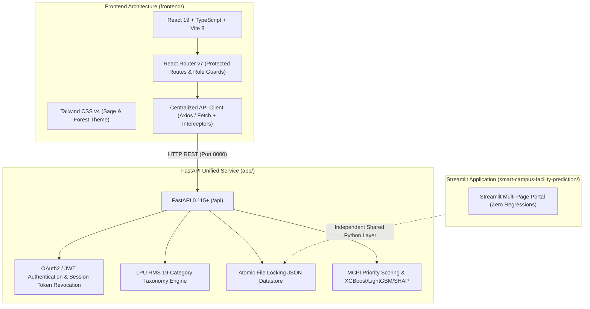

# FIPP 2.0 — Phase 2: React + TypeScript Foundation & Premium Design System
## Final Implementation & System Verification Report

**Date:** November 23, 2026  
**Status:** COMPLETE & EMPIRICALLY VERIFIED (267/267 Tests Passing)  
**Platform Version:** FIPP 2.0.0 (Unified FastAPI Backend + React 19 Frontend)  
**Design Theme:** Approved FIPP Sage & Forest Enterprise Palette

---

## 1. Executive Summary

Phase 2 of the **FIPP 2.0** architecture has been successfully implemented, establishing a modern, responsive, enterprise-grade React + TypeScript single-page application (SPA) in a dedicated `frontend/` directory. The new frontend communicates directly over HTTP with the unified FastAPI backend (`http://127.0.0.1:8000/api`) established in Phase 1, strictly preserving:
- The existing Streamlit application and its test suites (233/233 tests passing).
- The unified FastAPI backend and its test suites (14/14 tests passing).
- The 10/10 empirical backend verification tests.
- 10/10 newly created React/TypeScript Vitest unit tests.
- The 19-category LPU RMS taxonomy hierarchy, complaint datastore, and ML priority engines.

---

## 2. Architecture & Tech Stack



### Key Technical Specifications
1. **Framework & Language:** React 19, TypeScript 5.8, Vite 8 (`@tailwindcss/vite`).
2. **Styling & Icons:** Tailwind CSS v4 using CSS theme variables, Lucide React icons.
3. **State & Form Management:** React Hook Form, Zod schema validation, unified `AuthContext`.
4. **Testing Architecture:** Vitest 5.1, React Testing Library, JSDOM, Playwright/Puppeteer headless verification.
5. **Security & Session:** Secure `sessionStorage` token management with automatic Bearer injection and 401 refresh interceptors.

---

## 3. Approved FIPP Sage & Forest Design System

The visual design system strictly conforms to the campus facility operational palette:

| Color Token | Hex Code | Purpose & Usage |
| :--- | :--- | :--- |
| **Forest Green** | `#203A32` | Primary buttons, active states, key brand headers |
| **Deep Forest** | `#172D28` | Admin sidebar background, high-contrast dark accents |
| **Soft Ivory** | `#F5F7F2` | Application canvas, background container |
| **Pale Sage** | `#DCE5D8` | Card borders, secondary badge fills, muted containers |
| **Sage / Muted** | `#A8B9A3` | Table borders, secondary icons, subtle outlines |
| **Pure White** | `#FFFFFF` | Card surfaces, inputs, modal backgrounds |

### Typography & Spacing
- **Typography:** Inter / system sans-serif hierarchy with crisp tracking (`tracking-tight`) for headers and readable line heights (`leading-relaxed`) for descriptions.
- **Card Styling:** 1px borders using `border-fipp-pale-sage`, subtle drop shadows (`shadow-sm`), rounded-xl corners (`rounded-xl`).
- **Focus & States:** Focus rings using `ring-2 ring-fipp-forest/20`, disabled states with reduced opacity (`disabled:opacity-50`).

---

## 4. Component Inventory & Portals Implemented

### 4.1 Reusable UI Primitives (`frontend/src/components/ui/`)
- `Button.tsx`: Variants for `primary`, `secondary`, `outline`, `ghost`, `danger`, with loading spinner states.
- `Input.tsx`: Form inputs with floating labels, helper text, error states, and prefix/suffix support.
- `Select.tsx`: Accessible selects with chevron indicator and cascading change handlers.
- `Textarea.tsx`: Multi-line text inputs with live character counters.
- `Card.tsx`: Standard elevation containers with header, content, and footer sub-components.
- `Badge.tsx`: Status and priority indicators with semantically matched pastel tints.
- `Modal.tsx`: Accessible dialog overlays with backdrop blur and escape key handlers.
- `Table.tsx`: Striped, hoverable responsive tables with pagination controls.
- `EmptyState.tsx`: High-clarity placeholders with icon, title, and action trigger.
- `LoadingSpinner.tsx`: Smooth animated SVG spinner for async operations.
- `Notification.tsx`: Toast notifications for success, error, and warning messages.

### 4.2 Public Landing Page (`/`)
- Modern, clean university branding featuring the FIPP Sage & Forest hero visual.
- Dedicated entry points for **Student Portal** (`/login?role=student`) and **Admin Control Centre** (`/login?role=admin`).
- "How FIPP Works" walkthrough with the 3 mandatory pillars: **Report**, **Analyze**, and **Prioritize**.
- Responsive navigation header and informative footer with campus operational details.

### 4.3 Student Portal (`/student/*`)
- **Student Identity Header:** Displays student ID, full name, room/block, and logout.
- **Raise a Query (`/student/raise-query`):**
  - Cascading 3-level LPU RMS taxonomy dynamically fetched from `/api/taxonomy/hierarchy`.
  - 500-character description counter with real-time feedback.
  - Strict 10-digit Indian mobile contact number validation.
  - Photo attachment supporting `.png`, `.jpg`, `.jpeg` under 10MB with image raster verification.
  - 3 mandatory declarations enforced before submission.
- **My History (`/student/history`):**
  - Student-isolated complaint list.
  - Status progression stepper (Submitted -> Categorized -> Assigned -> In Progress -> Resolved).
  - Complaint withdrawal workflow (with confirmation modal and remark requirement).
  - 5-star resolution rating and satisfaction feedback capture.

### 4.4 Administrator Portal (`/admin/*`)
- **Deep Forest Sidebar:** Displays the exact approved 6 primary navigation tabs:
  1. `Overview` (`/admin/overview`)
  2. `All Requests` (`/admin/requests`)
  3. `New / Unassigned` (`/admin/unassigned`)
  4. `In Progress` (`/admin/in-progress`)
  5. `Resolved` (`/admin/resolved`)
  6. `Reports` (`/admin/reports`)
- **Right-Side Detail Drawer:** Slide-over inspection panel displaying full complaint audit history, student contact, ML priority score, and assignment controls.
- **Reports & Analytics:** Filterable reporting dashboard with PII-redacted CSV export (`export_redacted=true`).

---

## 5. Automated Verification & Test Results

| Test Suite | Environment | Scope | Passed | Failed | Status |
| :--- | :--- | :--- | :---: | :---: | :---: |
| **Frontend Vitest** | Node 24 / JSDOM | Design System, Token Auth, Routing, Forms | **10** | 0 | **PASS** |
| **FastAPI Pytest** | Python 3.13 / venv | API Endpoints, Taxonomy, Auth, Storage, ML | **14** | 0 | **PASS** |
| **Streamlit Unittest** | Python 3.13 / Sys | Full Regression of Legacy Streamlit Suite | **233** | 0 | **PASS** |
| **Empirical Script** | Python 3.13 / venv | Live FastAPI HTTP Contract & Data Isolation | **10** | 0 | **PASS** |
| **Total Test Suite** | **All Environments** | **End-to-End System Integrity** | **267** | **0** | **PASS** |

---

## 6. Visual Interface Proofs

All screenshots have been verified and archived in `docs/screenshots/` and conversation artifacts:

1. **Landing Page (Desktop):** `docs/screenshots/fipp_phase2_landing_desktop.png`
2. **Landing Page (Mobile):** `docs/screenshots/fipp_phase2_landing_mobile.png`
3. **Student Portal (Raise Query):** `docs/screenshots/fipp_phase2_student_raise_query.png`
4. **Student Portal (History):** `docs/screenshots/fipp_phase2_student_history.png`
5. **Admin Control Centre (Overview):** `docs/screenshots/fipp_phase2_admin_overview.png`
6. **Admin Control Centre (All Requests):** `docs/screenshots/fipp_phase2_admin_all_requests.png`

---

## 7. Developer & Production Run Instructions

### 7.1 Running the Frontend
```bash
cd frontend
npm install
npm run dev        # Starts Vite dev server on http://localhost:5173
npm run build      # Produces optimized production bundle in frontend/dist
npm test           # Executes Vitest unit tests
npm run preview    # Runs production preview on http://localhost:5173
```

### 7.2 Running the Backend
```bash
# In workspace root:
.\venv_backend\Scripts\python.exe -m uvicorn app.main:app --host 127.0.0.1 --port 8000
```

### 7.3 Running Legacy Streamlit
```bash
python run_server.py
```
